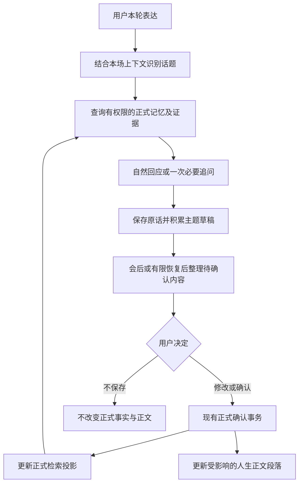

# 记忆驱动对话与人生正文持续更新设计方案

版本：V1.0 · 日期：2026-10-08 · 状态：**待用户审阅，未批准实施**。

本轮只归档设计，不改代码、不调用模型、不部署、不操作手机或历史记忆，不提交推送。本方案不代表已通过任何新增验收。新增跨链路产品行为归入产品设计；已知缺陷的原始证据仍保存在问题修复目录。

## 1. 用户希望得到的体验

回响根据用户正在聊的内容，带出有证据支持的旧经历，顺势追问尚不清楚的信息。对话结束后按主题归纳为少量待确认内容；用户确认后，将新经历放入人生正文的合适主题和位置。已有相关段落时整合更新，没有时新增，不机械堆叠句子，也不把对话记录原样贴入正文。

这份正文是一份随着用户表达和确认不断完善的人生记录。正文的可读性来自主题、时间和因果关系的组织，不靠每段固定添加“后来”。

必须同时做到：

1. 记得有依据：找到了什么旧事实、什么时候有效、是谁的经历，内部可核对。
2. 追问自然：用户已经说清楚的不再问；一次优先问一个问题，可跳过、转移话题或结束。
3. 归纳准确：保留时间、原因、计划、频率及变化，不添写用户未说过的经历。
4. 用户可决定：查看、修改、确认、不保存继续沿用现有流程；没有新增“审核中”业务状态。
5. 更新有位置：同一主题形成连贯段落，不按固定事实数量拼段，不把全篇重写作为每次确认的前置条件。
6. 保存可靠：新能力不能让短场、长场、开麦和音频发生回退。正文组织失败不能阻塞候选发布或撤销已成功的正式确认。

## 2. 现状核对：哪些已存在，哪些还缺失

以下来自2026-10-08本地源码与已归档现场报告，不等于本轮读取了服务器当前运行状态。

| 项目 | 已核对现状 | 设计含义 |
|---|---|---|
| 正文段落 | `_MAX_BLOCK_MEMORIES = 3`，粗分类后每三条切块；首块固定开头，其余固定“后来” | 要修改正文组织算法，单换提示词无效 |
| 段落顺序 | 合并记录按内部 groupId 排序，再生成块 | 不能把这个顺序解释为事件发生顺序 |
| 阅读页面 | iOS读取 lifeStory 的章节标题及正文，再做文本排版 | 优先修正文派生，不能只在UI删除“后来”掩盖混排 |
| 正文缓存 | 已有 source fingerprint、缓存和受影响章节增量推导 | 复用现有能力；新算法版本必须进入缓存失效判定 |
| 正式记忆调用 | 已有正式记录可读、实际文字追问 query-no-match 的重复现场证据 | “读得到正式接口”不等于“聊天已获得相关记忆”；根因仍未确定 |
| 文字 Context | 存在检索、筛选、权限绑定、引用和回退实现 | 必须沿实际授权路由核对，不将shadow/QA结果冒充生产回答路径 |
| Live | `DialogLiveGroundingPlan.sessionSnapshot`，`usesTurnScopedKnowledgeContext=false`，由Provider回答 | 不能假定支持每轮动态补充记忆；必须验证原生受控更新能力 |
| 确认 | 已有提案、版本/哈希绑定、关联操作、幂等与未知结果保护 | 复用，不另建直接写正式记忆的捷径 |

源码定位：

- [正文分块与固定连接词](/Users/gaominge/Documents/Codex/Video/DreamJourneyBackend/app/domain/owner_truth/person_memory_model.py:835)
- [现有正文缓存与派生入口](/Users/gaominge/Documents/Codex/Video/DreamJourneyBackend/app/services/owner_truth_person_memory_profile.py:321)
- [检索选择实现](/Users/gaominge/Documents/Codex/Video/DreamJourneyBackend/app/services/owner_truth_context_shadow_build.py:164)，实际接入还需核对 `owner_truth_context_authority.py`、`owner_truth_answer_citation.py` 和 `app/main.py` 的运行路由。
- [Live快照与回答权归属](/Users/gaominge/Documents/Codex/Video/DreamJourney_dev/DreamJourney/Sources/Services/DialogEngineManager.swift:886)
- [人生记录阅读页](/Users/gaominge/Documents/Codex/Video/DreamJourney_dev/DreamJourney/Sources/Modules/Archive/OwnerTruthFormalMemoryViewControllers.swift:310)
- [已确认的重复判定与争议差异修复](</Users/gaominge/Documents/liftora/02-问题修复/记忆系统/2026-10-08-主题争议提案缺少变更字段/部署与真机验证.md>)。这项修复不等于检索或正文组织已修复。

本方案需要修改提示词，也需要补检索/交互连接、主题关联和正文派生。具体字段复用和接口变更须在实施第一阶段对当前分支重新核对，本文不虚构现有SDK接口。

## 3. 用户场景与预期对话

### 3.1 尚无可用咖啡记录

用户：“我现在开始喜欢喝咖啡了。”

内部：成功完成相关记忆查询，未找到可引用咖啡经历。不能因此推断过去不喝。

回响：“是最近才开始喜欢的吗？有什么契机？”

用户：“就最近两年，因为工作忙，喝咖啡能让我提神。”

回响：“听起来它慢慢成了工作时的小习惯。现在主要是为了提神，还是也开始喜欢它的味道了？”

如果用户不回答味道问题，整理只采用已经说清楚的内容，不补出味道偏好。

待确认示例：

> **最近的咖啡习惯**\
> 最近两年，工作比较忙，我开始喝咖啡提神，也逐渐喜欢上了喝咖啡。

确认后放入“饮食与日常习惯”下的咖啡段落。用户没有说每天喝、喝几杯、喝什么品种，就不写这些信息。

### 3.2 有明确的“大学喝过—之后停喝”经历

只有两段旧经历都有当前可用证据时，才能这样回应：

回响：“你之前提过，大学备考时喝过咖啡，后来停了一阵。这次又开始喝，是有什么变化吗？”

用户：“对啊，那时候为了考研。最近两年工作忙，需要喝咖啡提神，我又开始喜欢喝咖啡了。”

内部：识别为不同时期的同一习惯变化。既往备考经历和最近工作状态可以同时成立，不能直接判为矛盾。

待确认示例：

> **咖啡习惯的变化**\
> 大学备考时，我曾靠喝咖啡提神，之后停喝了一段时间。最近两年工作忙，我又开始喝咖啡，也逐渐喜欢上了它。

页面应展示本次补充和整合后的可读内容；若涉及旧事实更正，展示有实质变化的前后内容。用户确认后更新原咖啡段落，不新增两个意思相近的正文段落。

### 3.3 只知道大学喝过，不知道是否停喝

回响：“你以前提过大学时喝咖啡，现在喜欢它的原因有什么不同吗？”

不能说“又开始”“中间停过”。用户自己明确说明停喝后，才有依据连接两个阶段。

### 3.4 用户纠正旧记忆

用户：“不是我大学时喝，是我室友。”

先承认并澄清主体；本轮交流立即按用户新说明继续，不反复引用错误旧说法。持久化修改仍生成关联更正待确认，由用户决定。用户拒绝保存时，正式记录不变，不能把对话中的临时工作假设直接升级为正式事实。

### 3.5 检索失败、用户不想展开或话题跳转

- 检索超时/不可用：沿用户当前表达正常回复，不声称“你没有这段记忆”，不在语音中念内部错误。
- “不想细说”：停止追问，不视为拒绝保存全部已说内容；是否保存仍由待确认操作决定。
- 转到新主题：跟随用户，之前足够成文的草稿保留，不能强迫答完咖啡问题。
- 一两轮就结束：已有足够信息也必须生成待确认；追问不是整理的门槛。
- 只问“咖啡有什么种类”：公共知识回答继续沿用现有规则，不能把模型的知识回答变成用户的饮食习惯。

## 4. 信息依据与完整流程

三类材料必须区分：

| 材料 | 用途 | 不能做什么 |
|---|---|---|
| 原始对话和本场上下文 | 理解指代、时间、用户当前说法；保存证据 | 不经确认写成长期正式记忆 |
| 当前有效的正式事实及证据 | 带出旧经历、判定新旧关系、建立正文事实基础 | 不越权读取家人/其他档案，不把失效版本当当前事实 |
| 人生正文 | 给用户连贯阅读的派生呈现 | 不能成为唯一检索依据或反向提取新事实写回记忆 |

查询“正文里有没有”，技术上应查正文背后的正式事实，而非只搜索正文字符串。正文暂未更新或换一种说法，不能导致已经确认的事实不可用。

旧经历可以保留在当前有效的时间线事实中；已被纠正、撤销的旧版本不能仅因为“需要回忆”又被当真引用。需要说明更正历史时，必须按现有版本和权限契约单独处理。

## 5. 对话检索与追问设计

### 5.1 检索输入与结果

检索线索包括当前话题、最近相关上下文、明确主体和时间。仅用当前一句“是啊”“后来呢”不足以检索，应继承本场最近主题；用户转移话题时不得沿用旧主题强行匹配。

建议内部提供以下语义信息，优先复用现有Context字段，而非直接新增一套API：

- 当前账号、档案、权限代次；会话/轮次标识。
- 话题线索、指代依据、查询关联标识。
- 检索结果状态：命中、成功但无命中、服务不可用/超时；三者不能混为一类。
- 被选中的 memoryId、versionId、内容哈希、证据、时间范围和确定程度。
- 已覆盖的记忆修订/投影检查点、筛选与预算原因。

先验证“已存在事实是否检索到”，再验证“结果是否进入真实回答请求”，最后验证“回答是否正确引用”。查询接口返回200、模型说“我记得”、前端显示正文，都不能单独作为通过依据。

### 5.2 追问规则

- 每次最多一个主要问题，优先补最有价值的一个缺口：时间、动机、变化或具体经历。
- 不设必须完成的字段清单和固定追问轮数。用户明确已回答的信息不重复问。
- 引用旧事要与当前话题相关；不为了展示记忆能力频繁插话。
- 不确定关系使用可纠正的问法，不把模型推测当成事实前提。
- 普通陪聊、情绪回应、用户提问仍正常进行，不把每句话都变成访谈。
- 不完整信息可以形成较短的准确记忆；不鼓励为凑长文持续提问。
- 追问内容和模型复述不作为独立用户证据。提问含多个推断时，用户一句“嗯”不能默认全部确认；要结合实际指代和语境，含糊部分不写入。

### 5.3 提示词职责

对话提示词：只能将附带证据的正式记忆表述为“你曾提过”；无命中与故障都不得推断不存在；已获知的时间原因不重复问；用户更正优先用于本轮理解。

整理提示词：区分新事实、已有事实、补充、时间变化与更正；保留原句中的计划/频率/不确定性；按具体主题归纳，不把模型回答写成用户事实。

正文提示词：仅基于选定且已确认的事实生成指定主题段落；必须返回每句对应的事实版本引用；禁止凭空补出先后、动机、停顿期、情感和人物重要性。

这些是待实现的提示词约束，不是只要写入提示词就能保证成立。身份、权限、版本、并发与证据覆盖由代码保证。

## 6. Live 接入限制及不破坏音频的方案

### 6.1 推荐目标

保留现有火山原生Live回答权、音色、播放和十分钟自然告别。后台查询相关记忆，以SDK/供应商明确支持的方式，将有界的记忆上下文送入正确的后续回答轮次。不要同时让后端另生成一份语音回答，不改为两个模型抢答。

### 6.2 实施前必须验证的能力

当前生产路径是开场快照。以下能力尚未在本轮证实，属于开工后的技术验证关卡：

1. 当前SDK是否支持在活动会话内更新记忆上下文，以及支持的正式接口与事件顺序。
2. 更新何时生效，能否绑定到本轮回答前；晚到是否只能下轮生效。
3. 更新是否会触发额外回复、打断当前播放、清空上下文或重启会话。
4. 当前模型/资源的上下文与载荷限制，字符、字节和token的计量不能混用。
5. 多轮、插话、主题切换、停止和重开时，旧检索结果能否被可靠隔离。

必须用受控SDK测试和真实火山合成内容验证，保留发送、接受、生效和回答证据。不能恢复已退役的逐轮载荷接口来假装兼容。

如果只能下一轮生效，本轮先自然回应/追问，下一轮在证据已到达时再带出旧事；不能为了等待检索让用户听到长时间沉默。如果根本不支持安全更新，只能把“开场快照范围内记忆可用”作为有限能力，不能验收成任意话题检索通过。切换整个Live回答架构属于扩大范围，需更新设计并由用户确认，不在本方案默认实施授权内。

### 6.3 延迟、容量与隔离

- 检索、主题判定和正文工作均不得同步占用音频回调、主线程送帧或保存队列。
- 每轮至多一个有效检索请求，主题不变且记忆修订相同可复用；取消被新话题取代的请求，禁止无界排队。
- 结果绑定会话、轮次、话题和权限代次。旧轮结果迟到不得覆盖新主题，更不能进入新场。
- 不传全量人生正文或全量记忆。按相关性与预算选择，保留时间变化所需的相邻事实；预算不足时宁可减少回忆，也不截断关键否定/时间限定。
- 检索超时不阻塞用户原话保存、不结束Live，不自动新增模型重试。
- 拟定本地检索等待预算500ms，作为起始配置而非现网承诺；真实环境测量后在实施报告冻结。首答、开麦和插话的既有SLO保持不变，必须记录相同环境修前/修后p50/p95及最大值。无法满足时不得简单拉长已有超时上限。

## 7. 新旧记忆关系与待确认内容

### 7.1 关系决策

| 情况 | 默认处理 | 用户可见结果 |
|---|---|---|
| 没有相关事实 | 新增 | 一条完整的新主题内容 |
| 同一事件、同一意思 | 去重/补证据 | 不重复生成同义待确认条目 |
| 同一主题新增细节 | 补充 | 整合的新段落，保留必要新增信息 |
| 不同时期的习惯变化 | 时间变化 | 保留先前阶段，补入新阶段，不直接判为冲突 |
| 用户明确纠正过去说法 | 更正 | 展示将改变的旧内容和新内容 |
| 主体、时间或关系不确定 | 有界澄清；无法澄清则保留独立的新陈述 | 不硬合并、不覆盖旧事实，不因归属不明阻止其他可靠内容发布 |
| 跨档案或权限不允许 | 不关联 | 继续按当前有权访问的材料处理 |

既有关系判定与事务为基础。不能把 unknown/positive 的窄修复扩成任意差异都可合并；肯定/否定、事实主体、时间与来源边界仍需校验。

### 7.2 待确认展示与编辑

- 会中维持主题草稿，不持续向待确认列表推送半成品；结束及异常中断后沿现有恢复规则发布。
- 每个主题一张可读记录，必要时展开细项；不追求整场强行压成一条。工作、出生、饮食等无关主题不能为了少卡片而混排。
- 关联到旧正文时展示“已有相关内容”及“本次补充/修改后”的必要部分，不显示内部置信度、哈希、关系枚举。
- 正在编辑只属于本地交互状态，沿用草稿跨退出恢复。后台内容有新版本时保留用户输入，确认前展示变化并重新获取有效提案，不能悄悄覆盖。
- 用户编辑的内容沿现有ownerReviewed机制保存，并明确其编辑来源；不可伪造为原对话已经说过。
- 确认对象仍为事实与实际变更；显示的叙述不得暗含用户看不到的事实修改。普通同义润色不要求用户反复确认，任何新增事实意义都必须回到待确认流程。
- 拒绝只影响对应候选；已存在正式记忆不变。

## 8. 确认后的人生正文组织

### 8.1 定位规则

一级章节继续使用简洁、可理解的现有导航形式，主题粒度由内容决定。建议允许“个人经历、工作与学习、饮食与日常习惯、家人与重要的人、兴趣与计划”等章节，但不是要求每个用户必须有固定数量章节。

在章节下定位到具体主题，例如咖啡、植物观察、家庭联系，而非仅按粗维度把三条记录拼在一起。

- 已有同一主题：更新原段落或补充同主题子段。
- 有相关主题但内容独立：新增邻近段落，不覆盖旧段。
- 跨主题事实：选择一个主要位置，其他位置可内部关联，避免全文重复。
- 主题不明确：保留一段独立、忠实的内容；不能为了分类而丢失已确认事实。

主题和段落使用稳定内部标识，不用标题字符串或数组位置作为唯一身份。标题改名、段落移动不应改变其事实归属。

### 8.2 写作规则

1. 按相关主题组合，按可证实的事件时间组织。内部ID、保存时间和确认时间不充当人生先后顺序。
2. 相对时间保留原说法及对话参考日期。“最近两年”是近似范围，不能自动写成精确的起始月日。以后展示不得因自然时间流逝把它不断移动；可表达为“在某年谈起时，我说最近两年……”或已确认的近似年份。
3. 对明确时间变化使用“曾经、之后、如今”等自然表达；缺少先后证据不用“后来”“又”。
4. “打算”仍写为计划，“偶尔”仍保留频率；“提神”不扩写成“热爱咖啡文化”。
5. 禁止固定添加“因此成为重要的人”“这些经历让我一直看重……”等未经事实支持的结尾。
6. “这个角落”“这些照片”只有在本主题上下文能唯一消歧时才改成具体指代，不能猜测场所或对象。
7. 不把主题标题、公开知识或模型追问当作用户事实来源。
8. 以自然短段落为单位；长度是可读性约束，不是按几条事实机械切分。细节较多时分为同主题子段，保留信息覆盖。

### 8.3 派生、版本与失败处理

事实确认事务先成功提交。正文更新作为可重建派生工作，不能与外部模型生成绑定为一笔长事务。

建议复用既有版本、source fingerprint和增量章节机制，补齐：

- 当前事实修订、事实版本集合、派生算法版本、提示词/模型版本共同标识正文产物；修算法后即使事实没变，也不能继续命中旧缓存。
- 每个段落保存支持它的事实版本，每句内部保留证据映射。UI不展示这些技术字段。
- 只重建受影响主题及确有需要的概览；不改不相关章节的文字。
- 同主题并发确认时合并最新事实集合。旧生成任务迟到不能覆盖新修订；按版本比较后重建或放弃旧产物。
- 同一事实修订重复触发只产生同一有效派生结果，不重复插段或重复调用模型。
- 候选确认成功后，检索投影与正文派生各自更新；正文暂失败不能使正式记忆不可检索。
- 已确认事实更正/删除后立即避免继续显示被撤销陈述。旧段落仍可用的前提是其引用事实版本仍有效，不能以“保留旧正文”为由展示已删除内容。
- 生成失败时，展示当前有效事实的忠实短段作为降级结果或保留仍有效的旧段，并给简短“正文仍在更新”提示。不能显示“记忆保存失败”，也不能无限重试。此提示只属于正文阅读，不增加回响结束后的业务状态种类。

正文生成采用有界后台派生，不在页面读取GET、正式确认事务或音频线程中同步等待模型。按账号/主题合并重复任务，设置并发、耗时、token和重试预算；预算数值先经本地与真实模型测量，再写入实施配置。不能因新正文任务挤占原采集、尾批整理和发布Worker的资源。用户反复刷新只查询派生结果，不触发无限新生成。

### 8.4 模型使用与发布边界

推荐“确定性主题/证据约束 + 有界模型润色”，必要时模型辅助主题判断。只向模型发送相关主题的必要事实，不发送全账户正文。

正文生成输出建议包含段落标题、正文和逐句支持的事实版本。代码检查身份、版本、必需限定信息和引用有效性；语义校验无法确定时使用忠实降级表达。**正文校验失败仅阻止该派生段落替换，不影响候选发布、正式确认成功或其他主题。**

不能仅让同一个生成模型自评“忠实”就判通过；要有反例、独立事实覆盖检查及真实模型样本。用户允许长对话少量遗漏，并不意味着正文可以随意丢掉已确认的时间、否定、原因等关键含义。

## 9. 影响范围和保护清单

| 模块 | 允许范围 | 明确保护 |
|---|---|---|
| 后端检索/Context | 定位query-no-match、上下文主题检索、相关事实与时间证据 | 权限、事实主体、已确认范围、公共事实回答能力 |
| 文字回响 | 相关记忆注入、自然追问 | 原始输入保存、答复可用性、结束整理 |
| 原生Live适配 | 经能力验证后的有界记忆上下文更新 | Provider回答权、开麦、音频回调、播放、插话、火山音色、十分钟告别 |
| 提取/主题草稿 | 新旧关系建议、具体主题归纳 | 短场不足一批也可整理；异常结束补缺/有限恢复仍有效 |
| 确认 | 复用提案与关联变更预览 | 现有幂等、版本冲突、未知结果只读核实，不能自动重试写入 |
| 正文派生 | 主题定位、段落组织、受影响片段更新 | 不回写或篡改正式事实，不重写全篇，不阻塞保存 |
| iOS记忆内页 | 关联内容必要预览、正文段落阅读 | 首页、底栏、入口、编辑/确认/拒绝与通知中心不重构 |
| 运维 | 必要阶段计数、版本、耗时和失败原因 | 默认不记录正文、完整提示词或用户隐私 |

本次不是“仅UI修改”，三入口共享的确认、检索和正文能力会受影响，必须共同回归。SDK原生更新若无法安全实现，不能以本方案为由随意更换整个语音架构。

## 10. 分阶段实施顺序与停止条件

用户审阅同意后才进入开发。每阶段完成证据和回归后进入下一阶段，不跨过已知失败。

| 阶段 | 交付 | 进入下一阶段的条件 |
|---|---|---|
| S0 现状与基线 | 精确定位实际问答query-no-match断点，核对真实路由、当前部署/源码、派生缓存；冻结基线 | 事实→检索→Context→实际模型请求的差异有证据；未知仍标未知，不靠扩大提示词遮掩 |
| S1 文字回响 | 相关正式记忆检索、自然追问、话题切换和检索失败降级 | 咖啡场景与反例真实回答通过，原保存/确认链通过 |
| S2 Live验证与接入 | 原生SDK能力报告，再做最小范围适配 | 真实模型证明记忆更新生效，无双重回答/额外开麦/音频打断；不具备能力则标阻塞并重新讨论替代架构 |
| S3 主题与确认关联 | 新增、补充、时间变化、更正及必要预览 | 用户可理解将写入内容，拒绝/编辑/版本冲突和未知写入保护通过；短场和异常收尾仍能发布 |
| S4 正文组织 | 稳定主题定位、证据约束润色、局部更新、降级及缓存失效 | 不再按三条拼段；无无依据“后来”；并发/删除/重建不丢事实；不相关章节保持不变 |
| S5 完整验收 | 三入口及真实短场→十分钟闭环，质量与性能对照 | 以逐项证据裁定，不用部分通过或构建成功替代整体通过 |

新功能开关应按对话检索/Live注入/正文派生分开，便于局部回滚。默认上线方式和参数在验收后决定。回滚只撤新策略，不删除已确认记忆或恢复已被用户更正的旧事实。

历史正文的重建属于单独受控操作：先测试账号预览和事实覆盖核对，再由用户决定范围；本方案不授权批量改写历史数据。

## 11. 验收矩阵

### 11.1 业务与内容

| 编号 | 场景 | 必须观察到的结果 |
|---|---|---|
| M01 | 无咖啡记录 | 自然询问时间/契机；不声称用户以前不喝；确认后新增正确主题 |
| M02 | 有大学喝咖啡及停喝证据 | 正确带出旧事；最近工作饮用作为新阶段；旧经历保留 |
| M03 | 只有大学喝过 | 不编造停喝，不擅自用“又” |
| M04 | 用户更正是室友 | 当前对话按纠正继续；正式变化需用户确认；主体不混淆 |
| M05 | 用户只说“嗯”或拒绝展开 | 不默认确认追问中的所有推断；不阻塞已有可靠内容整理 |
| M06 | 话题突然转到照片/植物 | 不继续咖啡问卷，不把不同主题写进同段 |
| M07 | 最近两年、偶尔、计划 | 时间精度、频率与计划属性保留，正文随日期推移不漂移 |
| M08 | 查询超时/真无命中 | 内部可区分；都不冒称已查无事实；聊天和保存继续 |
| M09 | 确认后立即追问/冷启动追问 | 新正式事实进入实际模型上下文并被正确使用；有调用证据 |
| M10 | 编辑/拒绝候选 | 编辑内容按既有确认机制生效；拒绝不改变旧正文与正式事实 |
| M11 | 同主题连续补充 | 待确认未审核时更新同条并保护本地编辑；已确认则生成关联补充 |
| M12 | 正文算法更换但事实不变 | 旧模板缓存失效；新正文无机械连接词与按数量混排 |
| M13 | 局部主题更新 | 咖啡段更新；出生、家人等不相关段落不变 |
| M14 | 生成失败/模型返回无证据句子 | 不发布错误段落，使用忠实降级；正式保存及候选发布不受阻 |
| M15 | 删除/更正、旧任务晚到 | 被撤销事实不可继续可见；旧结果不能覆盖新版本 |
| M16 | 家人档案、跨账号切换 | 只能取当前有权范围；旧查询/正文结果被隔离 |
| M17 | 一两轮短聊或不足一批 | 保存→待确认→修改/确认/拒绝→正式读取完整可用 |
| M18 | 回答公共问题 | 现有公共事实能力保留；公共回答不成为私人经历 |

### 11.2 三条输入入口

文字回响和Live均验证完整“表达→检索/回应→待确认→编辑/确认/拒绝→正式记忆→正文更新→实际再次调用”。档案新增记录没有即时对话环节，不强塞聊天追问；验证“输入→待确认→编辑/确认/拒绝→正式记忆→正文→回响实际调用”。

每条通过必须有本场身份、原始实际输入、候选与正式版本的对应关系。不得只比候选数量；必须核对内容含义、时间与证据。正式读取、正文可见、模型实际使用分开给结论。

### 11.3 Live与性能保护

- 每个长场前先独立短场门禁，同版本、同账号/档案、同构建指纹。
- 本方案以真实短场和产品十分钟自然告别为主要现场验收；不恢复65分钟压力测试。若另需20/40分钟，只能在用户后续明确要求并有对应产品模式时进行。
- 开麦耗时、首答/逐轮延迟、非静音真实播放、打断恢复、火山告别音色及完整播放均验证，不用模拟器假音频代替。
- 十分钟必须观察到产品自己完成告别关麦，测试工具停止请求为0；不足十分钟不得用收尾整理耗时补足。
- 转写同音差异记录后继续对话和收尾，待用户裁定内容；不能再次由关键词不匹配提前结束测试。真正断音、身份错绑和数据缺失仍保留失败。
- 故障发生后沿现有有界收尾观察，继续核对已保存正文及候选，不因首错就丢弃兜底证据，也不以兜底成功覆盖原失败。
- 新场开始前按用户既有要求归档并清理旧测试内容；验证旧记忆关联的用例要显式准备专用咖啡基线，保留它跨该用例的新对话，不能误删该用例的必要历史。只操作授权测试范围，保留清理证据。

### 11.4 真实模型与证据要求

本地受控模型覆盖格式错误、超时、旧结果、遗漏、错误主题合并及无依据因果；真实供应商验证提示词理解、语义归纳、上下文限制和动态注入。两者分别记录。全部模拟返回理想结果不能构成真实模型通过。

每次现场保存：源码/构建/配置指纹，检索命中与过滤计数、权限和版本绑定，Context接受/生效记录，逐轮实际转写，主题与事实映射，确认回执，正文受影响段落及前后差异，正式调用证据，音频/延迟指标。默认脱敏元数据；必要正文仅在已授权测试范围留存。

正式验收状态分列：本地、隔离集成、真实模型、真机短场、真机十分钟、声学体验、部署与历史重建。任何未跑项标NOT_RUN；用户阅读质量评审属于独立验收，不能用测试数量代替。

## 12. 需要用户审阅的产品取舍

以下为本文推荐默认值，尚未视为用户批准：

1. 确认前看清本次内容与必要的旧记忆变化；确认后自动更新对应正文，不为纯措辞润色再增加一次确认。
2. 人生正文按主题组织，并在主题内保留时间变化；既不写成流水账，也不强行写成带虚构情节的自传。
3. 本场追问围绕缺少的信息，一次一个主要问题，不强求固定问答数量。
4. 相关记忆临时取不到时，优先保持自然对话与保存；不能假装已经回忆，也不允许无界等待。
5. 正文暂时整理失败，正式记忆仍保存成功；阅读页只作轻量提示，不把用户逼回Live重新说一遍。
6. 不改记忆档案首页与导航布局，不恢复技术列表和内部指标展示。

## 13. 归档与实施约束

- 本方案：[本文件](<2026-10-08-记忆驱动对话与人生正文持续更新设计方案.md>)。
- 既有UI边界：[记忆页面信息精简](</Users/gaominge/Documents/liftora/02-设计文档/产品设计/记忆页面信息精简/2026-10-08-记忆页面信息精简设计方案.md>)。本方案明确扩展内容行为，但不推翻首页和信息隐藏约定。
- 既有问题：[问题登记册](</Users/gaominge/Documents/liftora/02-问题修复/DreamJourney问题登记册.md#dj-mem-recall-20261006>)。该问题原登记P2非阻断观察；本方案把其可靠检索能力列为新体验前置条件，不在设计阶段擅自改成已修或调整登记优先级。
- 工具规则：[转写差异不中断测试](</Users/gaominge/Documents/liftora/02-问题修复/测试与验收/2026-10-08-转写差异不中断真机测试/分析与修复设计.md>)。
- 审阅通过后，每阶段在同目录补“实施与验证”，详细缺陷仍登记到02-问题修复并相互链接；保存失败证据、实际影响面、回滚条件及NOT_RUN项。
- 不借本方案批量清理账号、改写历史正文、调用真实模型、部署或推送；开发、外部测试及发布分别按用户后续指令执行。

### 13.1 详细设计与执行文件（2026-10-08补充）

- [详细设计与接口约束](<2026-10-08-详细设计与接口约束.md>)：将产品要求对应到模块、逻辑字段、并发和降级边界。
- [分阶段实施与验收计划](<2026-10-08-分阶段实施与验收计划.md>)：每阶段先定义断言，再实现、验证和裁定；不得用本地结果代替真实模型或真机。
- 本次补充仅细化设计，未开始开发；各阶段初始状态为NOT_STARTED / NOT_RUN。
